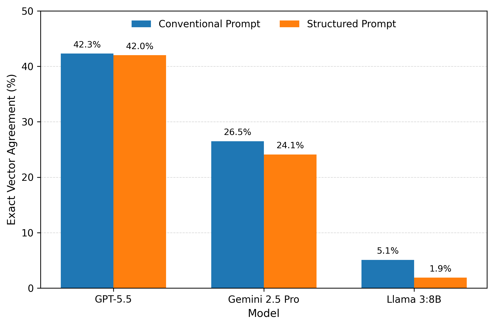
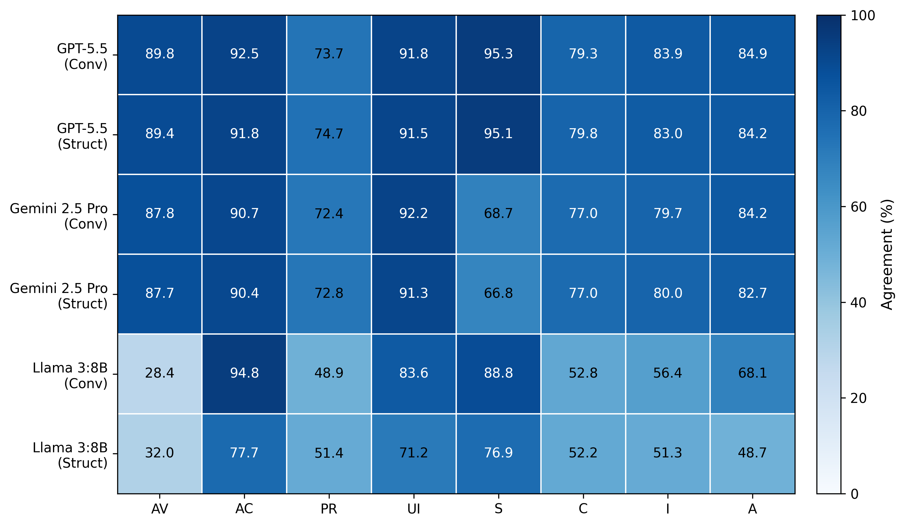
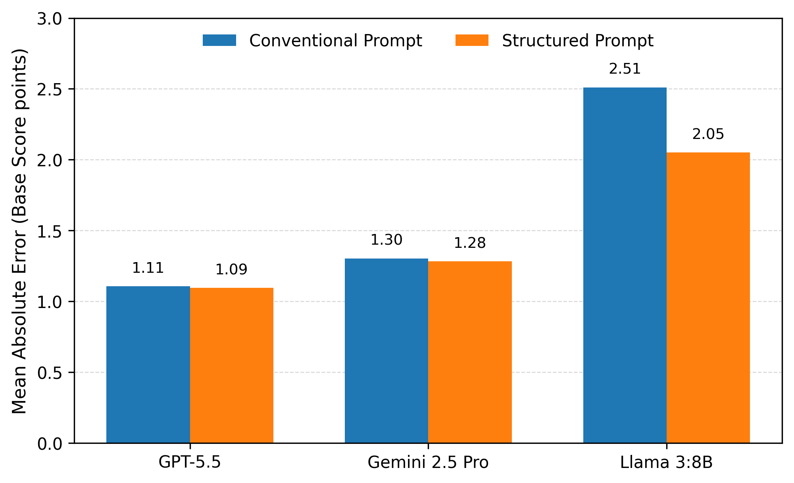
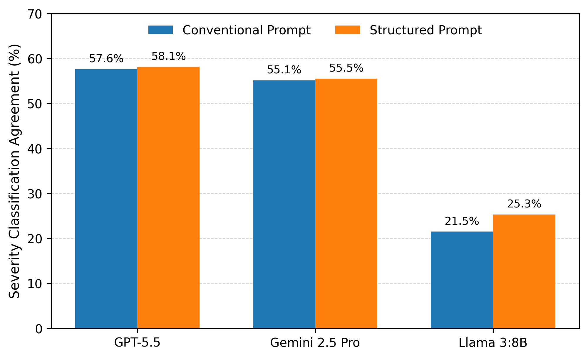
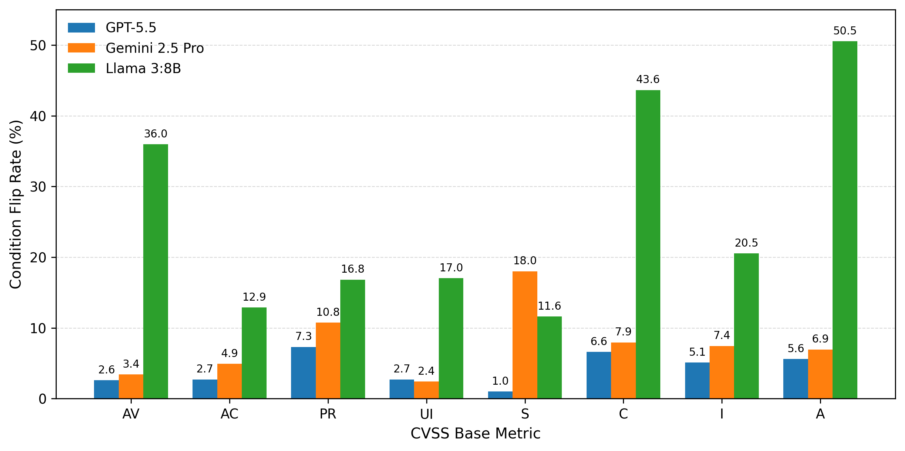
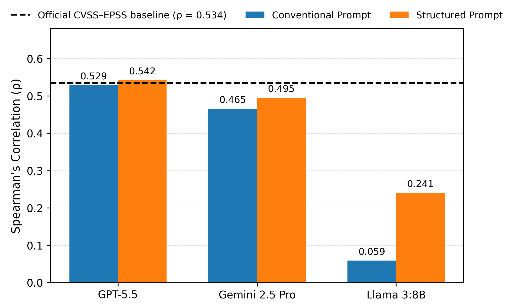

# Evaluating the Reliability of LLM-Based Vulnerability Scoring Using CVSS and EPSS

**MSc Applied Cyber Security Dissertation | Heriot-Watt University | 2026**

**Research Areas:** Cybersecurity · Artificial Intelligence · Vulnerability Management · LLM Evaluation · Data Analysis

---

## Project Overview

**Can large language models reliably assess the severity of cybersecurity vulnerabilities?**

Organisations regularly discover vulnerabilities in their systems, but not every vulnerability poses the same level of risk. Security teams use established scoring systems to understand vulnerability severity and prioritise remediation.

As Large Language Models (LLMs) become increasingly capable of interpreting technical information, an important question emerges:

**Can these models reliably support vulnerability assessment, and how much should we trust their scores?**

This MSc dissertation investigated that question by evaluating three LLMs against established vulnerability-scoring information, examining their accuracy, output reliability, and performance under different prompting approaches.

The objective was not simply to identify the best-performing model, but to understand **where AI-generated security assessments succeed, where they fail, and what those failures mean for real-world vulnerability management.**

---

## Understanding CVSS and EPSS

Two established cybersecurity metrics informed this research:

- **Common Vulnerability Scoring System (CVSS):** Describes technical vulnerability characteristics and produces a severity score from 0 to 10.
- **Exploit Prediction Scoring System (EPSS):** Estimates the probability that a published vulnerability will be exploited in the wild within the next 30 days.

These metrics address different questions.

A vulnerability may have high technical severity without necessarily having a high predicted likelihood of exploitation.

This research primarily evaluated how accurately LLMs reproduced reference CVSS assessments and also examined the relationship between model-generated severity scores and EPSS.

---

## Research at a Glance

| Research Component | Details |
|---|---|
| **Models Evaluated** | OpenAI GPT-5.5, Google Gemini 2.5 Pro, Llama 3:8B |
| **Pilot Study** | 50 Common Vulnerabilities and Exposures (CVEs) |
| **Main Study** | 1,000 CVEs |
| **Main-Study Responses** | 6,000 |
| **Prompting Approaches** | Conventional and Structured |
| **Experimental Settings** | Temperature = 0, Seed = 42 |
| **Evaluation Focus** | CVSS vector accuracy, severity agreement, scoring error, parsing reliability and EPSS relationships |

The research was conducted in two stages:

1. **Pilot Study:** Tested and refined the experimental approach using 50 CVEs.
2. **Main Study:** Extended the evaluation to 1,000 CVEs across three models and two prompting conditions.

---

## Research Methodology

### 1. Vulnerability Data Preparation

Vulnerability records were obtained from the **National Vulnerability Database (NVD)**.

The datasets were processed to prepare vulnerability descriptions and reference scoring information for model evaluation.

Data preparation included:

- CVE retrieval and selection.
- CVSS information extraction.
- Dataset sanitisation and validation.
- Preparation of inference inputs.
- EPSS enrichment.
- Quality assurance and consistency checks.

These steps supported comparisons between model-generated assessments and reference vulnerability scores.

### 2. LLM Evaluation

Three language models were evaluated:

| Model | Deployment |
|---|---|
| **OpenAI GPT-5.5** | OpenAI API |
| **Google Gemini 2.5 Pro** | Google API |
| **Llama 3:8B** | Locally through Ollama |

Each model was tested using two prompting approaches.

**Conventional Prompting**

Provided the model with the vulnerability assessment task and instructions.

**Structured Prompting**

Used a more explicitly organised approach to guide the model through the assessment.

Both approaches were evaluated to determine whether structured instructions improved scoring reliability.

### 3. Evaluation and Validation

Model-generated outputs were parsed, validated, and compared against reference CVSS information.

The evaluation considered:

- **Exact Vector Agreement:** Whether the complete predicted CVSS vector matched the reference vector.
- **Per-Metric Agreement:** Whether individual CVSS components were predicted correctly.
- **Base-Score Error:** The numerical difference between predicted and reference scores.
- **Severity Agreement:** Whether predictions matched the reference severity category.
- **Output Completeness:** Whether responses could be successfully parsed and evaluated.
- **EPSS Relationship:** How model-generated CVSS scores related to exploitation-probability estimates.

---

## Key Findings and Results

### 1. Exact CVSS Vector Agreement



GPT-5.5 achieved the highest exact-vector agreement across both prompting conditions.

| Model | Conventional | Structured |
|---|---:|---:|
| **GPT-5.5** | 42.3% | 42.0% |
| **Gemini 2.5 Pro** | 26.5% | 24.1% |
| **Llama 3:8B** | 5.1% | 1.9% |

Even the strongest-performing model did not reproduce the complete reference CVSS vector in the majority of cases.

**Key Insight:** A plausible AI-generated vulnerability assessment is not necessarily technically accurate.

### 2. Per-Metric CVSS Agreement



The analysis examined agreement across individual CVSS components.

A model could correctly predict several individual metrics while still producing an incorrect overall CVSS vector.

**Key Insight:** Evaluating AI-generated vulnerability assessments requires examining the underlying technical characteristics, not just the final numerical score.

### 3. CVSS Base-Score Error



Mean Absolute Error (MAE) was used to evaluate numerical differences between model-generated CVSS base scores and reference scores.

This provided an additional perspective on scoring reliability beyond exact-vector matching.

**Key Insight:** Numerical proximity to a reference score does not necessarily mean the underlying CVSS vector is correct.

### 4. Severity Classification Agreement



The research evaluated whether models assigned vulnerabilities to the correct severity categories.

A model could identify the correct severity category while still producing an inaccurate CVSS vector.

**Key Insight:** Broad severity classification and precise technical vulnerability assessment represent different levels of accuracy.

### 5. Prompting Condition Analysis



The comparison examined how predictions changed between conventional and structured prompting.

Structured prompting did not consistently improve scoring performance.

For exact-vector agreement, all three models performed slightly better under conventional prompting.

**Key Insight:** More structured prompts do not automatically produce more accurate cybersecurity assessments. Their effectiveness must be measured empirically.

### 6. CVSS and EPSS Correlation



The research examined the relationship between model-generated CVSS base scores and EPSS values.

This analysis explored how AI-generated severity assessments related to estimates of exploitation likelihood.

However, CVSS and EPSS measure different aspects of vulnerability risk.

**Key Insight:** Correlation with EPSS should not be interpreted as proof that an AI-generated CVSS assessment is accurate.

---

## Output Reliability and Parsing Failures

Beyond scoring accuracy, the research investigated whether models produced outputs that could be successfully parsed and evaluated.

Across the **6,000 main-study responses**, 65 parsing failures were recorded. All occurred under structured prompting.

| Model | Parsing Failures |
|---|---:|
| **GPT-5.5** | 0 |
| **Gemini 2.5 Pro** | 5 |
| **Llama 3:8B** | 60 |
| **Total** | **65** |

These findings demonstrate that AI reliability involves both:

1. **Assessment accuracy:** Whether the generated vulnerability score is correct.
2. **Output reliability:** Whether the generated response is usable in an automated workflow.

**Key Insight:** An AI system may produce a response that appears informative but cannot be reliably processed or validated.

---

## Repository Structure

The repository preserves the pilot and main studies as separate stages of the research.

```text
MSc_LLM_CVSS_Project/
│
├── data/                      # Research data resources
├── docs/                      # Supporting documentation
├── notebooks/                 # Analysis notebooks
├── prompts/                   # Prompt-related resources
├── results/                   # Pilot-study outputs
│
├── scripts/                   # Pilot-study Python scripts
│   ├── create_pilot_dataset.py
│   ├── run_pilot_50.py
│   ├── analyze_pilot_accuracy.py
│   ├── analyze_pilot_completeness.py
│   └── ...
│
├── main_study/
│   ├── audit/
│   ├── datasets/
│   ├── docs/
│   ├── experiment_inputs/
│   ├── notebooks/
│   │   └── chapter4/
│   │       └── figures/
│   ├── results/
│   ├── runtime/
│   └── scripts/
│       ├── fetch_main_dataset.py
│       ├── create_main_experiment_inputs.py
│       ├── run_main_experiment.py
│       ├── analyse_main_accuracy.py
│       ├── analyse_main_completeness.py
│       ├── enrich_main_with_epss.py
│       └── ...
│
├── .gitignore
├── requirements.txt
└── README.md
```

The repository also contains supporting scripts for data sanitisation, model-response parsing, validation, inspection and quality assurance.

---

## Reproducing the Research

The repository contains the Python scripts, experimental inputs, analysis notebooks and supporting resources used for the pilot and main studies.

The following steps outline the research workflow and the environment required to repeat it.

### 1. Clone the Repository

```bash
git clone https://github.com/ihuomah/MSc_LLM_CVSS_Project.git
cd MSc_LLM_CVSS_Project
```

### 2. Prepare the Python Environment

Create a virtual environment:

```bash
python -m venv .venv
```

Activate it on Windows PowerShell:

```powershell
.\.venv\Scripts\Activate.ps1
```

For macOS or Linux:

```bash
source .venv/bin/activate
```

Install the project dependencies:

```bash
pip install -r requirements.txt
```

The requirements file contains the Python libraries used for model integration, CVSS processing, data analysis and supporting research activities.

### 3. Configure Model Access

The study used three language models:

- **OpenAI GPT-5.5:** Requires appropriate OpenAI API access.
- **Google Gemini 2.5 Pro:** Requires appropriate Google API access.
- **Llama 3:8B:** Requires a local Ollama installation and the corresponding model.

API credentials should be stored in environment variables or a local `.env` file.

**Never commit API keys or credentials to a public repository.**

Model identifiers and other experiment settings are defined in the project's configuration and inference scripts.

### 4. Prepare the Vulnerability Datasets

The research used vulnerability records from the **National Vulnerability Database (NVD)** and additional **EPSS** information.

The workflow involved:

1. Retrieving and selecting CVE records.
2. Extracting reference CVSS information.
3. Sanitising vulnerability descriptions and reviewing potential information leakage.
4. Enriching datasets with EPSS information.
5. Preparing and validating experimental inputs.

Pilot-study preparation scripts are available in `scripts/`.

Main-study preparation scripts are available in `main_study/scripts/`.

### 5. Run the Pilot Study

The pilot evaluated **50 CVEs** across three models and two prompting approaches, producing 300 expected model responses.

Relevant scripts include:

- `scripts/run_pilot_50.py` — pilot inference.
- `scripts/analyze_pilot_accuracy.py` — scoring accuracy evaluation.
- `scripts/analyze_pilot_completeness.py` — response completeness evaluation.

The pilot helped validate the inference, parsing and evaluation procedures before the larger experiment.

### 6. Run the Main Study

The main study evaluated **1,000 CVEs** across six model–prompt combinations, producing 6,000 model responses.

Relevant scripts include:

- `main_study/scripts/create_main_experiment_inputs.py` — experimental input preparation.
- `main_study/scripts/run_main_experiment.py` — model inference.
- `main_study/scripts/analyse_main_accuracy.py` — scoring accuracy evaluation.
- `main_study/scripts/analyse_main_completeness.py` — response completeness evaluation.

The experiment used **temperature 0** and **seed 42**.

### 7. Research Outputs

The pilot-study scripts are located in `scripts/`, with supporting outputs organised under `results/`.

The main-study scripts are located in `main_study/scripts/`, with supporting outputs organised under `main_study/results/`.

Additional datasets, experiment inputs, audit records and analysis notebooks are retained in their respective directories.

These are the repository's organisational locations; individual scripts may use more specific input and output paths.

### 8. Analyse the Results

Model responses were parsed, validated and compared with reference CVSS assessments.

The analysis covered:

- Exact-vector agreement.
- Per-metric agreement.
- Base-score error.
- Severity classification agreement.
- Prompting-condition changes.
- Output completeness and parsing failures.
- Relationships between model-generated CVSS scores and EPSS.

Supporting analysis notebooks, result files and figures are included in the repository.

### Reproducibility Notes

Reproducing the study requires access to the relevant model versions, API services, local model configuration and research inputs.

Model availability, provider updates and changes in NVD or EPSS data may affect subsequent results.

Although temperature 0 and a fixed seed were used to improve experimental consistency, they do not guarantee identical model outputs across different systems or future model versions.

The scripts document the experimental workflow, but the execution sequence and environment have not been independently verified as a clean, end-to-end reproduction procedure.

**Data Sources:**

- [National Vulnerability Database (NVD)](https://nvd.nist.gov/)
- [FIRST Exploit Prediction Scoring System (EPSS)](https://www.first.org/epss/)

---

## Technologies and Skills Demonstrated

| Area | Technologies and Methods |
|---|---|
| **Programming** | Python |
| **AI and LLMs** | OpenAI API, Google Gemini API, Ollama |
| **Data Analysis** | pandas, NumPy, SciPy |
| **Cybersecurity** | CVSS v3, EPSS, vulnerability assessment |
| **Data Sources** | National Vulnerability Database, EPSS |
| **Research Methods** | Experimental design, comparative evaluation, statistical analysis |
| **Automation** | Dataset processing, model inference, response parsing and validation |
| **Visualisation** | Python-based statistical charts and analysis |

---

## Limitations and Future Work

The findings reflect the selected models, datasets, prompting strategies and experimental configuration.

They should not be interpreted as universal performance guarantees for all LLMs or vulnerability-assessment scenarios.

Potential areas for further investigation include:

- Evaluating additional and newer language models.
- Testing alternative prompting and reasoning strategies.
- Repeating experiments to assess variability.
- Investigating human-in-the-loop verification.
- Exploring AI-assisted vulnerability prioritisation with independent validation.
- Evaluating integration into operational vulnerability-management workflows.

---

## Conclusion

This research demonstrated both the potential and the limitations of using Large Language Models for vulnerability scoring.

While some models produced substantially more accurate assessments than others, **exact CVSS vector reconstruction remained challenging across all three models**.

The findings also showed that structured prompting did not consistently improve accuracy and that output-format reliability varied significantly between models.

**The central conclusion is that LLMs may support vulnerability-analysis workflows, but their outputs should be independently validated before informing security decisions.**

The project highlights the importance of rigorous AI evaluation, reproducible experimentation and responsible adoption of AI in cybersecurity.

---

## About the Researcher

**Chinyere Uwa**

MSc Applied Cyber Security (**Distinction**)  
Heriot-Watt University, Edinburgh, United Kingdom

**Academic Supervisor:** Dr Manuel Maarek  
**Year:** 2026

**Portfolio:** [kymauwa.com](https://kymauwa.com)  
**GitHub:** [github.com/ihuomah](https://github.com/ihuomah)

This project demonstrates practical experience in cybersecurity research, AI model evaluation, Python-based automation, statistical analysis and communicating technical findings to different audiences.

---

*Academic research project — Heriot-Watt University, 2026.*
